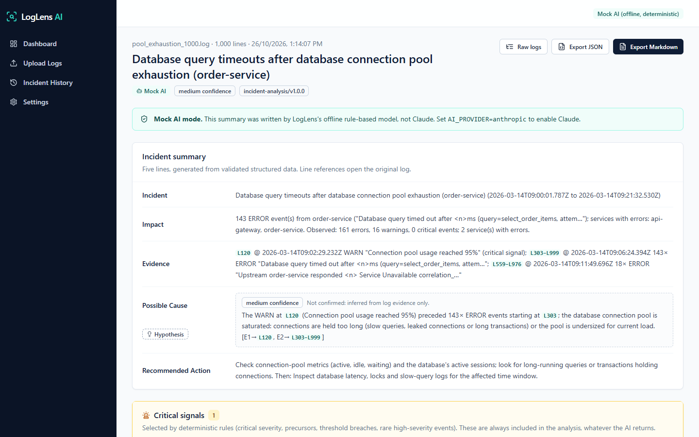
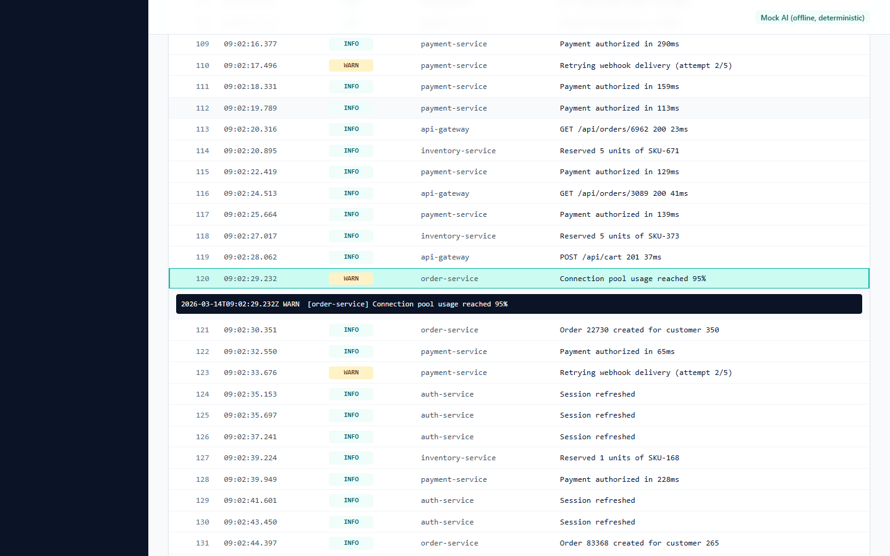
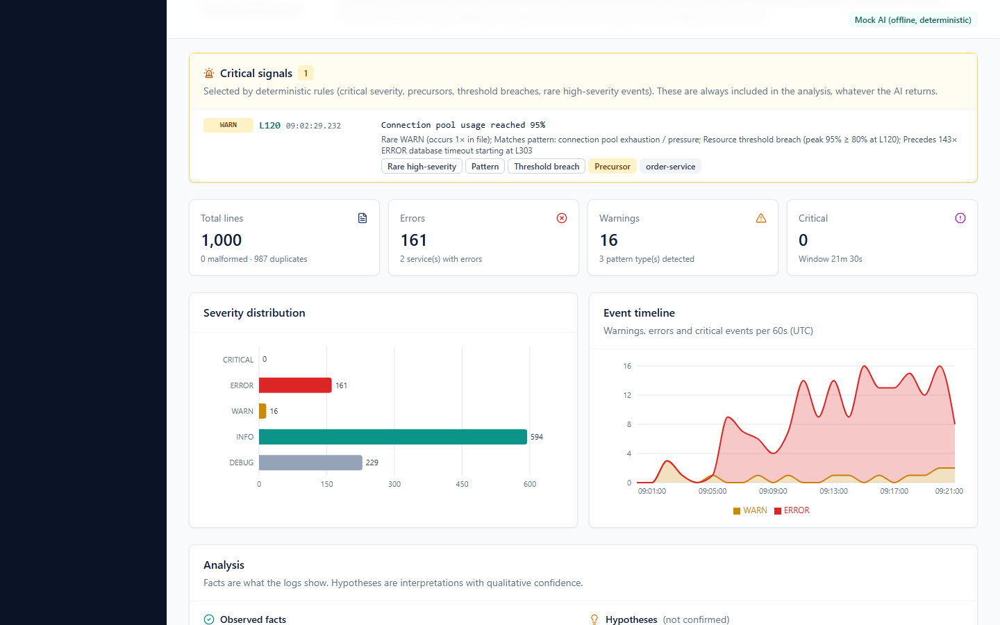
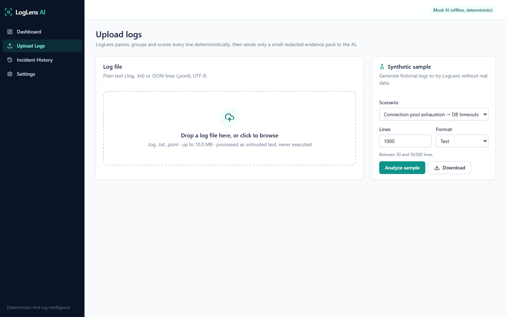
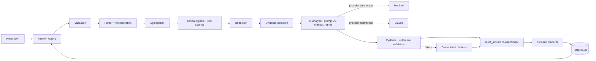

# LogLens AI

**Turn 1,000+ application log lines into an actionable five-line incident summary, without losing rare but critical warning signals.**

LogLens AI is a deterministic-first log intelligence platform. Python code parses, groups, scores and preserves the critical evidence. An LLM of your choice (Claude, OpenAI, Gemini, any OpenAI-compatible server, or a **local model via Ollama**) interprets a small, redacted, line-referenced evidence pack. The result is schema-validated and rendered as five lines: **Incident, Impact, Evidence, Possible Cause, Recommended Action**.

---

## 1. Problem

During an incident, the decisive clue is often one quiet warning, such as `WARN Connection pool usage reached 95%` at line 120, buried under 143 identical database timeouts. Grepping for `ERROR` misses it. Pasting the file into an LLM tends to summarize by volume, can present guesses as root causes, can leak secrets, and can be steered by text inside the logs.

## 2. Solution

- **Deterministic extraction first.** Every line is parsed (text and JSON), normalized and fingerprinted. Duplicates collapse into groups. A versioned pattern catalog flags DB timeouts, pool exhaustion, auth failures, memory pressure, service failures, disk pressure and rate limiting.
- **Critical-signal preservation.** Rules mark signals `must_include`: all CRITICAL events, rare WARN/ERROR events with patterns, threshold breaches (≥ 80%), precursors that come before a related error burst, and prompt-injection attempts. These are guaranteed to reach the final analysis, even if the model omits them or the AI call fails.
- **Bounded, redacted evidence.** Secrets, tokens, emails, credentialed URLs, card numbers and IPs are masked. Evidence items have stable IDs (`E1…`) and original line numbers and timestamps.
- **Bring your own model.** Claude, OpenAI, Gemini, OpenAI-compatible servers (Groq, OpenRouter, LM Studio, vLLM), or fully local models through Ollama, where logs never leave your machine. All providers go through the same validation and fallback.
- **Validated AI interpretation.** The model returns JSON (structured outputs), validated with Pydantic plus reference checks. Facts and hypotheses are separate. Confidence is qualitative. "Confirmed" root-cause claims are rejected.
- **Safe fallback.** Timeouts, provider errors, refusals and invalid output all degrade to a deterministic summary, and the UI says so.
- **Inspectable UI.** KPI cards, severity and timeline charts, a critical-signals panel, expandable evidence with the raw lines, a searchable raw-log explorer, history, and JSON/Markdown export.

## 3. Screenshots

| Incident summary | Raw log explorer (jump to L120) |
|---|---|
|  |  |
| **Charts, facts vs hypotheses** | **Upload & sample generator** |
|  |  |

Screenshots are captured automatically by `frontend/e2e/screenshots.spec.ts` against the mock-AI backend.

## 4. Live demo

_Placeholder: no public deployment has been made. See [docs/07-deployment.md](docs/07-deployment.md) to deploy your own (an authenticating proxy is required)._

## 5. Architecture



Full design (ER diagram, sequence diagrams, threat model, ADRs): [docs/02-architecture.md](docs/02-architecture.md).

## 6. Technology stack (pinned)

| Layer | Versions |
|---|---|
| Backend | Python 3.12, FastAPI 0.162.0, Starlette 1.10.0, Pydantic 2.14.1, pydantic-settings 2.16.1, Uvicorn 0.54.0 |
| AI | anthropic 2.3.0 (Claude), openai 3.39.0 (OpenAI + OpenAI-compatible), google-genai 2.33.0 (Gemini), Ollama REST via httpx 0.28.1 (local models), offline mock provider |
| Data | PostgreSQL 16, SQLAlchemy 2.1.6, Alembic 1.20.1, psycopg 3.3.6 (SQLite for tests) |
| Frontend | React 18.3.1, TypeScript 5.6.3, Vite 5.4.11, Tailwind CSS 3.4.15, shadcn/ui-style components (Radix Slot 1.1.0, CVA 0.7.1), Recharts 2.13.3, TanStack Query 5.59.20, React Router 6.28.0 |
| Testing | pytest 9.1.1, pytest-cov 7.1.0, Vitest 2.1.5, React Testing Library 16.0.1, Playwright 1.49.0 |
| Infra | Docker, Docker Compose, nginx 1.27, GitHub Actions |

## 7. Installation

Prerequisites: Docker **or** Python 3.12 + Node 22.

```bash
git clone <your-fork> loglens-ai && cd loglens-ai
cp .env.example .env            # set POSTGRES_PASSWORD
```

## 8. Running locally

**Docker (recommended):**

```bash
docker compose up --build -d
# UI http://localhost:8080   health http://localhost:8080/health/ready
```

**Without Docker** (also gives Swagger UI at `http://localhost:8000/docs`):

```bash
cd backend && python -m venv .venv && .venv/Scripts/activate && pip install -r requirements-dev.txt
uvicorn app.main:create_app --factory --reload --port 8000          # http://localhost:8000/docs
cd ../frontend && npm ci && npm run dev                              # http://localhost:5173
```

**Mock AI mode** is the default (`AI_PROVIDER=mock`): no API key, nothing leaves your machine, and it is clearly labelled in the UI.

**Choosing a model** (set in `.env`; see `.env.example`):

| Provider | Settings | Data leaves your network? |
|---|---|---|
| Claude | `AI_PROVIDER=anthropic`, `ANTHROPIC_API_KEY` | Yes (redacted evidence only); billed |
| OpenAI | `AI_PROVIDER=openai`, `OPENAI_API_KEY`, `OPENAI_MODEL` | Yes (redacted); billed |
| OpenAI-compatible (Groq, OpenRouter, LM Studio, vLLM) | `AI_PROVIDER=openai`, `OPENAI_BASE_URL`, `OPENAI_MODEL` (+ key if the server needs one) | Depends on the server; LM Studio/vLLM on your own machine keep it local |
| Gemini | `AI_PROVIDER=gemini`, `GEMINI_API_KEY`, `GEMINI_MODEL` | Yes (redacted); billed |
| **Local (Ollama)** | `ollama pull llama3.1:8b`, then `AI_PROVIDER=ollama`, `OLLAMA_MODEL=llama3.1:8b` | **No**: free, fully offline |

Local models on a CPU are slower: set `AI_TIMEOUT_SECONDS=120` or higher. Small models (about 3B parameters) often produce weaker or invalid analyses; LogLens then retries and falls back to the deterministic summary, so results stay correct but less descriptive. 7B+ models are recommended.

**Demo in 30 seconds:** open the dashboard → **Try a sample incident**. It generates 1,000 lines with the 95% pool warning at line 120 and 143 DB timeouts, then shows the summary with `L120` preserved.

## 9. Testing

```bash
cd backend  && pytest -q --cov=app            # unit, API, AI validation, injection, redaction, regression, performance
cd backend  && python -m eval.run_eval        # labelled evaluation dataset (mock provider)
cd frontend && npm test                       # component tests (Vitest + RTL)
cd frontend && npx playwright install chromium && npm run e2e   # end-to-end (starts backend + frontend)
```

The critical regression test is [backend/tests/test_regression_pool_warning.py](backend/tests/test_regression_pool_warning.py). It fails if the line-120 warning is missing from the signals, the evidence pack, the prompt, the final analysis or the Evidence summary line, including when the model ignores it or the AI fails. Results and coverage: [docs/06-testing.md](docs/06-testing.md).

## 10. AI prompt design

One provider-independent prompt and validation path serves every model. Versioned template `incident-analysis/v1.0.0`. Untrusted evidence is JSON-encoded inside `<log_evidence>` delimiters that cannot be forged. Claude structured outputs plus Pydantic validation, reference integrity checks, certainty-language rejection, confidence caps, token budgeting, bounded retries and a deterministic fallback. Details and limitations: [docs/05-ai-prompt-design.md](docs/05-ai-prompt-design.md).

## 11. Known limitations

- No user authentication or multi-tenancy. Deploy behind an authenticating proxy.
- Analyses run as in-process background tasks. A restart marks in-flight jobs `INTERRUPTED`.
- Redaction is regex-based. It does not detect names, addresses or other free-form PII.
- Injection detection is heuristic. Layered defenses bound the impact.
- Cloud-model output quality (Claude, OpenAI, Gemini) was **not** evaluated in this build (no API keys used); those adapters are tested against fake clients. A real local model (Ollama `llama3.2` 3B) was run; see `docs/06-testing.md`.
- Recharts 2.x is on its last major version line (v3 migration pending).
- Timestamps without a timezone are assumed to be UTC. Syslog timestamps without a year use the current year.

## 12. Future roadmap

1. Job queue (Redis + RQ/Celery) with retries and horizontal workers.
2. SSO/OIDC auth, RBAC and per-team retention policies.
3. Live ingestion (Loki, CloudWatch, Datadog) and multi-file correlation by correlation ID.
4. Entropy-based secret detection and NER-based PII redaction.
5. Live-Claude evaluation runs in CI (nightly, budget-capped) with regression tracking.
6. Feedback buttons on summaries to build a labelled dataset.
7. Recharts v3, virtualization for very large explorer pages.

---

Documentation: [PRD](docs/01-prd.md) · [Architecture](docs/02-architecture.md) · [UI design](docs/03-ui-design.md) · [API](docs/04-api.md) · [AI prompt design](docs/05-ai-prompt-design.md) · [Testing](docs/06-testing.md) · [Deployment](docs/07-deployment.md) · [Security](docs/08-security.md) · [Lessons learned & delivery review](docs/09-lessons-learned.md)
