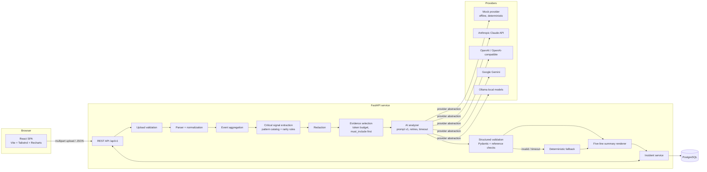
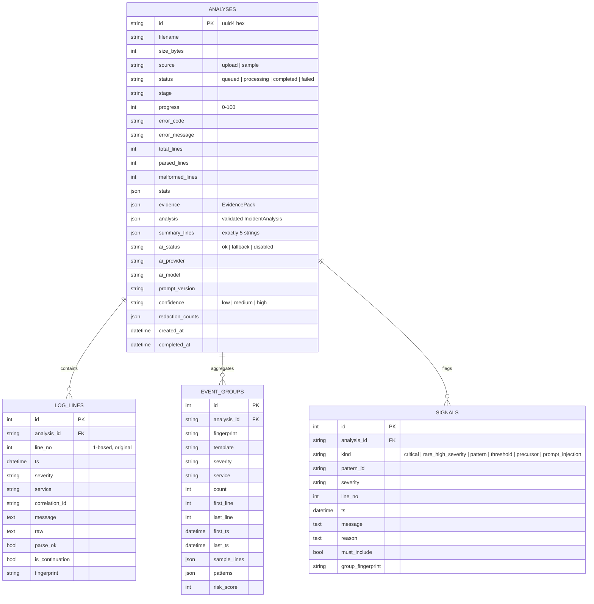
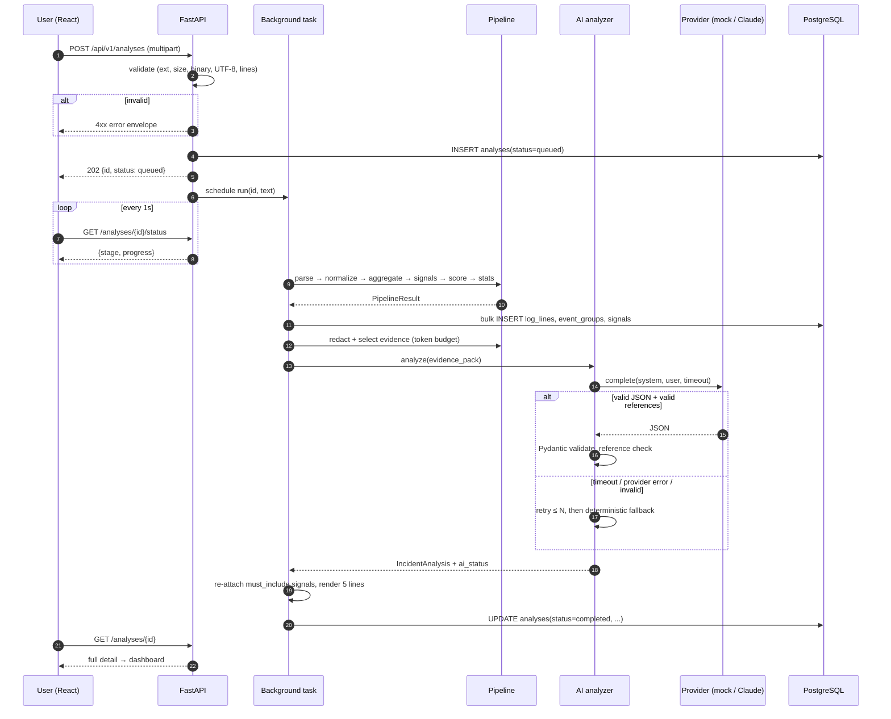
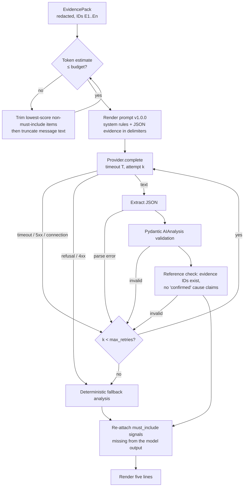

# LogLens AI — System Architecture

## 1. High-level architecture

The pipeline is **deterministic first**. Everything before the `AI analyzer` box is plain Python and fully unit-tested. The model only interprets a bounded, redacted evidence pack. After validation, the incident service re-attaches every `must_include` signal, whatever the model returned. That is how the system guarantees it never "loses" a rare critical warning.

## 2. Component responsibilities

| Component | Module | Responsibility |
|---|---|---|
| API layer | `app/api/v1/*` | Routing, request/response models, HTTP error mapping. Versioned under `/api/v1`. |
| Validation | `app/pipeline/validation.py` | Extension allow-list, size limit, empty check, NUL-byte/binary detection, UTF-8 decoding (BOM tolerant), line-count limit. |
| Parser | `app/pipeline/parser.py` | Detects JSON vs text per line. Extracts timestamp, severity, service, message and correlation ID. Marks malformed and continuation lines. Always keeps the raw line and its 1-based line number. |
| Normalization | `app/pipeline/normalize.py` | Canonical severity (`DEBUG`, `INFO`, `WARN`, `ERROR`, `CRITICAL`, `UNKNOWN`), UTC timestamps, message templating (fingerprints). |
| Aggregation | `app/pipeline/aggregator.py` | Groups events by `(severity, service, template)`. Tracks count, first/last line and timestamp, and sample line numbers. |
| Pattern catalog | `app/pipeline/patterns.py` | Ordered, versioned regex catalog: DB timeout, pool exhaustion/pressure, auth failure, memory, service failure, disk, rate limit. |
| Signal detector | `app/pipeline/signals.py` | Deterministic preservation rules: all CRITICAL, rare WARN/ERROR, pattern-matched WARN+, threshold breaches (≥ 80 % utilisation), precursors that come before a related error burst, suspected prompt injection. Marks `must_include`. |
| Risk scoring | `app/pipeline/scoring.py` | Explainable integer score per group: severity, pattern, volume, rarity and precursor weights. |
| Statistics | `app/pipeline/stats.py` | Severity counts, services, time range, timeline buckets, parse quality. |
| Redaction | `app/pipeline/redaction.py` | Masks emails, bearer/JWT tokens, API keys, AWS keys, passwords/secrets, credentialed URLs, card-like numbers and IPv4 addresses. Returns counts by category. |
| Evidence selection | `app/pipeline/evidence.py` | Builds `EvidencePack`: stable IDs (`E1…`), line refs, timestamps, redacted text. Must-include items first, then groups by risk score, within a token budget. |
| Orchestrator | `app/pipeline/orchestrator.py` | Runs the stages, reports progress (`stage`, `progress`) and returns a `PipelineResult`. |
| AI analyzer | `app/ai/analyzer.py` | Builds the versioned prompt, enforces the token budget, calls the provider with timeout and retries, parses JSON, validates schema and references, falls back deterministically. |
| Providers | `app/ai/providers/*` | `AIProvider` protocol. `MockProvider` (offline), `AnthropicProvider`, `OpenAIProvider` (+ OpenAI-compatible), `GeminiProvider`, `OllamaProvider` (local). |
| Summary renderer | `app/ai/summary.py` | Renders the five lines from validated structured data. Labels the hypothesis and confidence. |
| Incident service | `app/services/incident_service.py` | Persists results, enforces must-include re-attachment, list/get/delete, line queries. |
| Export service | `app/services/export_service.py` | JSON and Markdown renderers. |
| Sample generator | `app/samples/generator.py` | Seeded synthetic logs for scenarios (`pool_exhaustion` is the 1,000-line critical scenario). |

## 3. API contracts (summary)

Full reference: [`04-api.md`](04-api.md). Interactive docs: `/docs` (Swagger) and `/redoc`.

| Method | Path | Purpose | Success |
|---|---|---|---|
| GET | `/health/live` | Liveness | 200 `{status:"ok"}` |
| GET | `/health/ready` | Readiness (DB round-trip) | 200 / 503 |
| GET | `/api/v1/config` | Public runtime settings (AI mode, limits) | 200 |
| POST | `/api/v1/analyses` | Multipart upload (`file`). Starts an analysis. | 202 `AnalysisStatus` |
| POST | `/api/v1/samples/analyze` | Generate a synthetic log and analyze it | 202 `AnalysisStatus` |
| GET | `/api/v1/samples/download` | Download a synthetic log file | 200 text/plain |
| GET | `/api/v1/analyses` | History list (paginated) | 200 |
| GET | `/api/v1/analyses/{id}` | Full analysis detail | 200 / 404 |
| GET | `/api/v1/analyses/{id}/status` | Progress polling | 200 / 404 |
| GET | `/api/v1/analyses/{id}/lines` | Raw log search: `q`, `severity`, `service`, `around_line`, `page`, `page_size` | 200 |
| GET | `/api/v1/analyses/{id}/export?format=json\|markdown` | Export | 200 attachment |
| DELETE | `/api/v1/analyses/{id}` | Delete an analysis and its lines | 204 |

All errors use one envelope: `{"error": {"code": "FILE_TOO_LARGE", "message": "...", "details": {...}}}`.

## 4. Database schema

Indexes: `log_lines(analysis_id, line_no)` unique, `log_lines(analysis_id, severity)`, `event_groups(analysis_id)`, `signals(analysis_id)`, `analyses(created_at)`. Cascading deletes from `analyses`.

JSON columns use SQLAlchemy's generic `JSON` type, so the same models run on PostgreSQL (production) and SQLite (unit tests and quick local runs). Alembic manages migrations.

## 5. Log processing sequence

## 6. AI processing workflow

Details: [`05-ai-prompt-design.md`](05-ai-prompt-design.md).

## 7. Threat model (STRIDE-oriented)

| Asset / entry point | Threat | Mitigation |
|---|---|---|
| Upload endpoint | DoS via huge files or many lines | `MAX_UPLOAD_MB` and `MAX_LINES` limits. Reads bounded at limit + 1 byte. Proxy body limit in nginx. |
| Upload endpoint | Malicious file types or binary payloads | Extension allow-list, NUL-byte detection, strict UTF-8 decoding. Files are never written to disk or executed. |
| Log content → LLM | Prompt injection ("ignore previous instructions…") | Evidence is JSON-encoded inside `<log_evidence>` delimiters. The system prompt declares it untrusted data. Injection heuristics flag lines as `prompt_injection` signals. No tools or function calls are granted to the model. Output is schema-validated. The summary is rendered by our code. |
| Log content → LLM | Secret / PII exfiltration to a third party | Redaction before evidence selection. Only the evidence pack (not the whole file) is sent. Redaction counts are shown in the UI. |
| LLM output → UI | XSS via model text | React escapes text by default. No `dangerouslySetInnerHTML`. Markdown export is plain text. |
| LLM output → users | Hallucinated root cause | Cause stored as a hypothesis with qualitative confidence. "Confirmed" claims are rejected. Evidence IDs must resolve. |
| Raw log storage | Data at rest exposure | Operator-owned PostgreSQL. Configurable retention purge. No external storage. |
| API | Unauthenticated access | MVP is single-tenant. The deployment guide requires an authenticating reverse proxy / VPN. CORS is restricted to configured origins. |
| Secrets | API key leakage | Key only in the environment. Never logged or returned by `/config`. `.env` is git-ignored. |
| Logs → system | Command execution from log content | The pipeline treats lines as strings only: no `eval`, no shell, no template rendering of log content. |

## 8. Error-handling strategy

- **Validation errors** → 4xx with machine-readable codes: `EMPTY_FILE`, `FILE_TOO_LARGE`, `UNSUPPORTED_FILE_TYPE`, `BINARY_CONTENT`, `INVALID_ENCODING`, `TOO_MANY_LINES`, `NO_LOG_CONTENT`.
- **Malformed lines** → never fatal. Stored with `parse_ok=false`, counted in `malformed_lines`, shown in the explorer.
- **AI failures** → classified as `timeout`, `provider_error`, `refusal`, `invalid_json`, `schema_invalid`, `reference_invalid` or `not_configured`. Retried when transient. Always end in a fallback analysis with `ai_status=fallback` and a reason that the UI displays.
- **Unexpected pipeline exceptions** → analysis is marked `failed` with `PIPELINE_ERROR`. The stack trace goes to structured logs, never into the response.
- **Stale jobs** → on startup, analyses left in `queued`/`processing` are marked `failed` (`INTERRUPTED`).
- **Global handlers** → `HTTPException`, `RequestValidationError` and unhandled exceptions are mapped to the error envelope with a `request_id`.

## 9. Data retention and privacy assumptions

- Raw logs are stored in the operator's PostgreSQL, so users can inspect the original evidence. Nothing is written to the filesystem.
- `RETENTION_DAYS` (default 30) purges old analyses on startup and through `DELETE`. `0` disables the purge.
- Only the redacted evidence pack (by default ≤ ~6k tokens) is sent to the AI provider, and only when `AI_PROVIDER=anthropic`.
- Mock mode sends nothing externally.
- Operators remain responsible for their provider's data-processing terms.

## 10. Architecture decision records

### ADR-001 — Deterministic-first pipeline, LLM as interpreter
**Context:** LLMs summarize by volume and can drop rare lines. **Decision:** Parsing, counting, grouping, pattern detection and signal preservation are deterministic. The LLM only explains a curated evidence pack. **Consequence:** Results stay correct and testable even with AI disabled. AI quality affects wording and hypotheses, not facts.

### ADR-002 — `must_include` re-attachment after AI validation
**Context:** Even with good prompts, a model may omit a signal. **Decision:** After validation, any `must_include` evidence item the model did not cite is appended to `critical_signals` and to the Evidence line. **Consequence:** A hard guarantee, enforced by a regression test.

### ADR-003 — Provider abstraction with a mock provider
**Context:** CI and local development must not need a paid key. **Decision:** `AIProvider` protocol. `MockProvider` produces schema-valid JSON from the evidence pack with transparent rules and is clearly labelled "Mock AI" in the UI. **Consequence:** Deterministic tests. Anthropic is a configuration switch.

### ADR-003b — Multiple providers including local models
**Context:** Teams use different AI vendors, and many cannot send logs to any third party. **Decision:** Add OpenAI (and OpenAI-compatible servers), Gemini and Ollama providers behind the same protocol, each mapping its errors to the shared `ProviderError` kinds and requesting schema-constrained JSON. **Consequence:** One prompt and one validation path for all models. Local models give a fully offline option. Weaker models degrade to the deterministic fallback rather than producing wrong facts.

### ADR-004 — Background tasks instead of a queue (MVP)
**Context:** Analyses take seconds, not minutes. **Decision:** FastAPI `BackgroundTasks` plus status polling. **Consequence:** Simple to operate. Jobs are lost on restart (marked `INTERRUPTED`). A Redis/RQ or Celery queue is on the roadmap.

### ADR-005 — Generic SQL types (PostgreSQL in production, SQLite in tests)
**Decision:** Use SQLAlchemy 2.x with portable types (`JSON`, `String`, `DateTime(timezone=True)`). **Consequence:** Fast hermetic tests. The Postgres path is verified by the Alembic migration in Docker Compose.

### ADR-006 — Five-line summary rendered by code, not the model
**Decision:** The model returns structured JSON. Our renderer composes the five lines, inserting deterministic counts and line references. **Consequence:** The format is guaranteed, numbers are never hallucinated, and the hypothesis label cannot be removed.

### ADR-007 — Qualitative confidence only
**Decision:** Confidence is `low|medium|high` plus uncertainty notes. Deterministic rules cap it: for example, it can be at most `medium` with no corroborating precursor, and it is `low` in fallback. **Consequence:** No fabricated numerical certainty.

### ADR-008 — shadcn/ui-style components authored in-repo
**Decision:** The UI primitives (Button, Card, Badge, Input, Select, Tabs, Progress) follow shadcn/ui conventions (Tailwind + `class-variance-authority` + `tailwind-merge`) and are committed as source, as shadcn intends, instead of being generated by its interactive CLI. **Consequence:** Reproducible builds with no CLI step.
